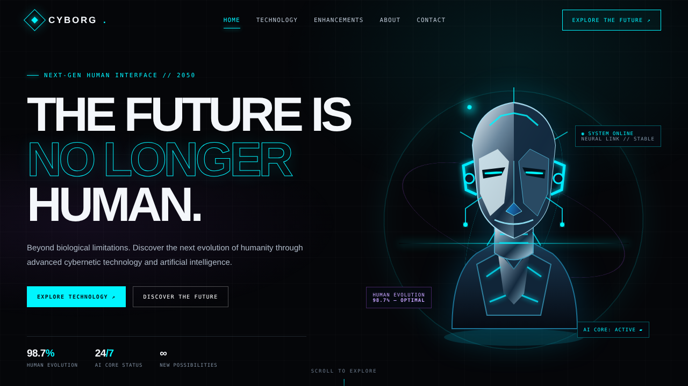

# CYBORG – The Future of Humanity



A responsive concept website about cybernetics, artificial intelligence and the next step of human evolution. Built with plain HTML, CSS and JavaScript, so there is nothing to install.

**Designed and presented by Netra Ladekar.**

## Features

- Hero section with an animated cybernetic humanoid illustration (SVG)
- Sticky navigation that highlights the section you are reading
- Mobile menu for small screens
- Scroll animations for each section
- Sections: Home, About, Technology, Enhancements, Showcase, Contact

## Project structure

```
.
├── index.html   # page structure and content
├── style.css    # all styling and animations
├── script.js    # navigation, mobile menu and scroll effects
├── hero.png     # preview image of the hero section
└── README.md
```

## Run it locally

1. Download or clone this repository.
2. Keep all files in the same folder.
3. Double-click `index.html` to open it in your browser.

## Publish with GitHub Pages

1. Upload all files to a new GitHub repository.
2. Open **Settings → Pages**.
3. Under **Branch**, choose `main` and the `/ (root)` folder, then click **Save**.
4. After a minute your site is live at `https://<your-username>.github.io/<repository-name>/`.

## Built with

- HTML5
- CSS3 (custom properties, grid, animations)
- Vanilla JavaScript (IntersectionObserver)
- Google Fonts: Space Grotesk and DM Mono

## Credits

Design and development: Netra Ladekar.
